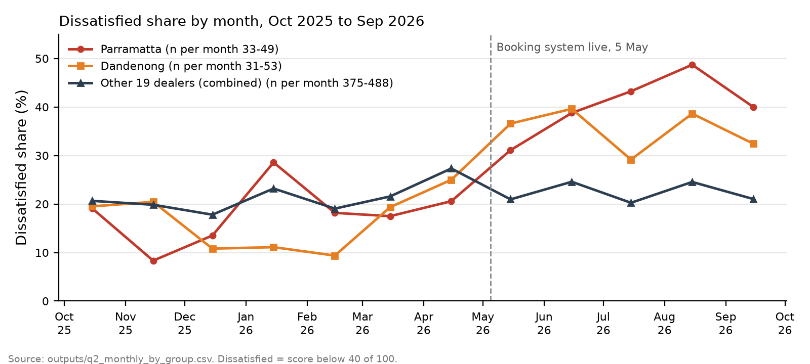

# Kestrel customer feedback: findings and recommendations

**For:** Head of Customer Experience  |  **By:** Evan Thapa  |  **Date:** 28 Oct 2026

**Basis:** 7,070 feedback rows kept from 52 dealer files (24 dealers, Oct 2025 to Sep 2026). "Dissatisfied" means the bottom 40% of a rating scale after putting every dealer's scale on 0 to 100 (for example 1 or 2 out of 5). "At risk" means 50 or below. D-numbers are decisions logged in `profiling/data_governance.xlsx`. Detail is in `docs/appendix.md`.

## 1. Headline answers

- **Q1. Where and why (confidence: medium to high).** Service is the problem: 27.2% of Service responses are dissatisfied, against 16.2% in Parts and 10.1% in Sales. The leading complaints are not being kept informed (28% of dissatisfied comments) and waiting (24%). In Parts the main complaint is waiting (47%). In Sales it is staff (34%).
- **Q2. What changed (medium).** Dissatisfaction rose from 18.9% to 24.4% (Oct to Dec 2025 against Jul to Sep 2026, 21 dealers). Most of the rise is at Parramatta and Dandenong, which stayed high from May while the other 19 dealers fell back to about 20% to 25%. Without those two, the rise is +2.4 points and not statistically significant.
- **Q3. What to fix first and what it is worth (high on the ranking, low on the dollars).** Under stated assumptions, about $2.5m a year of Service and Parts revenue is at risk (range $1.2m to $7.2m). Communication ($0.71m) and waiting ($0.65m) come first. There is no churn data, so the dollars are an estimate. The ranking does not depend on the assumed leave rate.

## 2. Recommendations

1. **Service: set a status-update standard** so every open job gets a call or text by an agreed time. Evidence: communication is the top theme (28.6% of the value at risk). Measure: its share of dissatisfied Service comments (29% now) and the Service dissatisfied rate (27.2%).
2. **Parts: tell customers about back-orders with an expected date.** Evidence: waiting is 47% of dissatisfied Parts comments. Measure: that share and the Parts dissatisfied rate (16.2%).
3. **Review the booking rollout at Parramatta and Dandenong.** Since May, 20.2% and 17.7% of their dissatisfied responses mention the booking system, against 3.1% at other dealers. Check call-backs and availability, and confirm the go-live date and any logging change. Measure: their dissatisfied share returning towards pre-May levels (about 17% to 18%).
4. **Sales: read the staff-attitude comments to find the pattern** (34% of dissatisfied Sales comments, n=140). The dollar effect is indicative only.
5. **Data requests:** Penrith June 2026, Toowoomba raw data for Oct to Dec 2025 (and whether it surveys Sales), Bendigo's "S" code, and confirmation of the Hunter and Ipswich dealer codes.

## 3. What drives negative feedback (Q1)

**By department.** Service has 4,836 responses and is 27.2% dissatisfied (38.9% at risk), Parts 697 and 16.2%, Sales 1,527 and 10.1%. Sales is 88.7% of the $839m revenue but has the lowest dissatisfied share (Service: [appendix D](docs/appendix.md#d-detail-cut-from-the-report)).

**By dealer.** Differences are modest: most dealers are 20% to 25% dissatisfied. The highest are Parramatta (27.8%), Rockhampton (25.7%), Dandenong (25.4%), Southport (25.2%) and Chatswood (24.8%), and the highest cells are all Service: Parramatta 36.3% (n=311), Dandenong 34.5% (n=319) and Chatswood 31.1% (n=180). Noosa's 2.0% (49 responses) is not comparable, because its feedback cards suggest selective collection (Issues_Log I087; [appendix D](docs/appendix.md#d-detail-cut-from-the-report)).

**By theme** (primary theme, share of dissatisfied customer comments):

| | n | Communication | Waiting | Price | Work quality | Process | Staff |
|---|---|---|---|---|---|---|---|
| All | 1,436 | 28% | 24% | 14% | 13% | 11% | 8% |
| Service | 1,191 | 29% | 25% | 14% | 15% | 12% | 5% |
| Parts | 105 | 25% | 47% | 13% | 0% | 1% | 12% |
| Sales | 140 | 26% | 5% | 18% | 7% | 7% | 34% |

Counting any mention, communication appears in 49% of dissatisfied comments. A typical comment: "left a voicemail, sent a text, and emailed. triple silence."

*Sources: q1_by_department, q1_by_dealer, q1_by_dealer_department, q1_theme_by_department, revenue_context, theme_example_quotes. Excluding Essendon and Ipswich (where staff write up feedback) moves no share by more than 1.8 points.*

## 4. Change over the year (Q2)

- **The rise is concentrated.** The dissatisfied share rose from 18.9% to 24.4% across 21 dealers (+5.5 points). It survives resampling whole dealers (interval +1.0 to +10.6) and dropping any one dealer (minimum +3.6), though the lower end is near zero. Service rose 6.8 points, Sales 5.5, and Parts fell 5.9. Only 10 of 21 dealers rose: Parramatta (14.2% to 44.0%) and Dandenong (17.2% to 33.3%) account for +3.3 of the 5.5 points, and without both the rise is +2.4 (interval -0.5 to +5.7).
- **The booking system fits, but is not proven.** A note in Dandenong's May file says a new online booking system went live on 5 May. After it, booking mentions in dissatisfied responses rose from 8.2% to 20.2% at Parramatta and from 2.3% to 17.7% at Dandenong. At Parramatta, satisfied responses fell and complaints about communication (33% to 44%) and waiting (31% to 41%) rose, which looks like a real service problem; at Dandenong the note also says "log everything", so part of the jump is probably more logging. But dissatisfaction was already high before the launch, in April (26.8% group-wide, 27.3% at the other 19 dealers, 25.0% at Dandenong, n=40), and the Process and facilities label did not rise at Parramatta (33% to 32%). The timing fits a booking-system effect but does not prove one.

*Sources: q2_monthly, q2_monthly_by_group, q2_robustness, q2_dealer_drivers, q2_without_dealers, q2_change_by_department, q2_collection_check, q2_parramatta_themes.*

## 5. What to fix first and what it is worth (Q3)

**Method (D9).** Revenue at risk = annual revenue for the dealer and department x dissatisfied share x assumed leave rate. Low is 5% leaving, base 10%, high 20% of the wider at-risk group; these rates are my assumptions, because there is no churn or repurchase data. Sales is shown separately, not in the headline: a car already sold is not recurring revenue, and in my first method car sales made up most of the total.

| Case | Service + Parts (headline) | Sales (indicative only) |
|---|---|---|
| Low | $1.23m | $0.76m |
| Base | $2.47m | $1.91m |
| High | $7.17m | $6.15m |

By theme (base case, Service and Parts; priority = frequency x severity x fixability):

| Theme | $m | Share | Severity | Fixability | Priority |
|---|---|---|---|---|---|
| Communication | 0.71 | 28.6% | 32% | 3 | 1 |
| Waiting | 0.65 | 26.2% | 34% | 2 | 2 |
| Work quality | 0.34 | 13.8% | 59% | 2 | 3 |
| Price and billing | 0.33 | 13.5% | 35% | 3 | 4 |
| Process and facilities | 0.28 | 11.3% | 54% | 2 | 5 |
| Staff attitude | 0.14 | 5.8% | 9% | 2 | 6 |

Work quality is less common but the most severe of the common themes (severity: the dissatisfied share of a theme's comments). Fixability (1 to 3) is my judgement, and the top three are the same without it. Most revenue at risk (base): Parramatta $195k, Dandenong $185k, Chermside $163k.

*Sources: q3_revenue_at_risk, q3_theme_split, q3_priority, q3_by_dealer, q3_sensitivity_headline.*

## 6. Data quality

I read 52 files and 82 sheets (7,271 rows, reconciled to my profiling manifest) and logged 161 issues in 10 groups; 201 rows were excluded, each with a reason. The ones that change results:

- **Scales.** Geelong 2025 is reversed (1 = Excellent, per a banner; 68 rows), so I flipped it first, and the rating-versus-wording check passes after the fix. Ringwood changed template mid-file (second header at row 37), from a 1 to 5 scale to out of 10 (321 rows), and each block is scored on its own scale.
- **Dates.** Liverpool Q3 is month first (56 values with a second part above 12). Shepparton has 6 dates after its 31 March closure, moved back one year (D4).
- **Copies were excluded:** Penrith "Jun 26" copies "Jul 26" (43 rows), Chermside FINAL is inside FINAL v2 (112), plus 12 Essendon rows in two tabs and 16 other exact duplicates.
- **Gaps, not zeros:** Penrith June 2026, and Toowoomba Oct to Dec 2025 (a summary with no Sales and no individual rows). **Inferred mappings, awaiting confirmation:** Bendigo "S" as Sales (32 rows, D3), and Hunter and IPS as Newcastle and Ipswich (580 rows, D8).
- **Personal data** columns were dropped on reading and contact details in comments redacted before any model call; staff first names were not fully redacted until a later fix (section 8).

*Sources: bronze_reconciliation, exclusions, dq_rule_log, sentiment_check_pools, Issues_Log and Decisions_Log.*

## 7. Approach, trust and AI use

- **Dataset design.** One row per feedback response, with the dealer, department, month, original score and scale, a 0 to 100 score, the redacted comment, the AI theme and sentiment, and the source file, sheet and row. Files are stacked, not joined, because they are different slices of the same thing. The only join is to monthly revenue on dealer and month, which gives a separate dealer-by-month-by-department table rather than extra columns. Bronze keeps every row as read, silver is cleaned and redacted, and gold adds the AI labels and revenue. Excluded rows stay in the table with a reason (columns: `data_dictionary.md`).
- **Assumptions.** (1) A score's scale comes from the file's banner or its observed range, and every score is rescaled to 0 to 100. (2) "Dissatisfied" is the bottom 40% of that scale. (3) Missing months are gaps, not zeros. (4) Leave rates of 5%, 10% and 20% are my assumptions, because there is no churn data. (5) Annual revenue per dealer and department comes from monthly_revenue.csv, and Sales is shown separately from the headline (D1, D5, D9 in `profiling/data_governance.xlsx`).
- **Tech choices.** Python and pandas, because every file needs its own rules and a per-file mapping config is easier to read and test than SQL. Eight closed themes so results can be counted and checked against my labels. Claude Haiku 5.5, because it is cheap ($1.23 for the full run, `outputs/derived_numbers.csv`) and fast enough to re-run. The model sees the comment text only, so I can test its labels against the ratings. Every response is cached, so a rerun is offline and identical, and a fresh-clone test with no API key reproduced the cleaned data, the gold table and every analysis output exactly.
- **Ringwood.** Scores out of 10 test the dissatisfied rule: 62 of 63 scores of 1 to 4 are AI negative or mixed, which supports 1 to 4 as dissatisfied. A 6 is mostly mixed (15 of 18), and at risk is 25.5% at 5 or below against 32.1% at 6 or below, so I kept the same rule as every other dealer for comparability and show 6 or below only as a sensitivity, which means Ringwood's at-risk share may be understated (`outputs/evaluation/ringwood_d2.csv`, `outputs/d2_ringwood_sensitivity.csv`).
- **The model and its accuracy.** Claude Haiku 5.5 labelled 5,150 comments (5,090 calls, 0 failures). Against 120 comments I labelled blind, sentiment is 96.7% accurate (95% interval 91.7% to 98.7%, kappa 0.95) and primary theme 85.8% (78.5% to 91.0%, kappa 0.82), or 96.7% if either of my two themes counts. Kappa measures agreement beyond chance. Most misses swap two themes on a comment about two things.
- **Weak spots.** Process and facilities has precision 0.56 (7 labelled rows), and the booking finding uses it. Vehicle or product and Other were not in my sample, so I checked 14 and 20 AI-labelled comments: the AI's theme was right for 6 and 3 (precision only), and both hold under 1% of dissatisfied comments. All 10 cleaned rows I checked against the source spreadsheets matched.
- **How I used AI.** The analysis and the decisions are mine: the theme definitions, the 120 blind hand labels, the dissatisfied threshold, the exclusions, the leave rates and the dollar method. I did the hand checks (the spot check and the extra check) and authorised the redaction fix. Claude Code wrote the pipeline to my spec and generated a fact pack of every number with its source file; a separate Claude chat drafted the report text from that pack, which I rewrote and checked.
- **Where the AI was wrong, and how I caught it.** It said the model I specified did not exist (the pricing page showed it did), reported 163 colliding record IDs, then 76, when an independent check showed 0, and let car sales dominate its first dollar method. Its staff-name check reused the redaction code's case-sensitive pattern, so 152 comments with a staff first name were missed and relabelled for $0.037. Full log: `ai_usage_log.md`; more detail: [appendix D](docs/appendix.md#d-detail-cut-from-the-report).

*Sources: evaluation_report, per_theme, ringwood_d2, d2_ringwood_sensitivity, extra_check_summary, spot_check, derived_numbers, data_dictionary, run_log.*

## 8. Limits and next steps

- **One labeller, small sample.** 120 labels from one person; Noosa (37 customer comments) has no rows in the sample. Responders are not all customers, and collection differs by dealer (cards, surveys, staff logs).
- **Dollars and thin cells.** Leave rates and fixability are assumptions, revenue for gap months sits in the annual base, and 29 of 48 headline cells use the department theme mix. 47 of 66 dealer-by-department theme cells have under 30 comments, so dealer-level theme claims are indicative.
- **Staff names reached the model before the fix** (152 of 5,349 comments, 23 dealers). Redaction is now case-insensitive and independently checked, but it is best effort.
- **Next step: prompt v2** with explicit rules for explaining how a vehicle works and for short "easy" comments, validated on a fresh sample.
